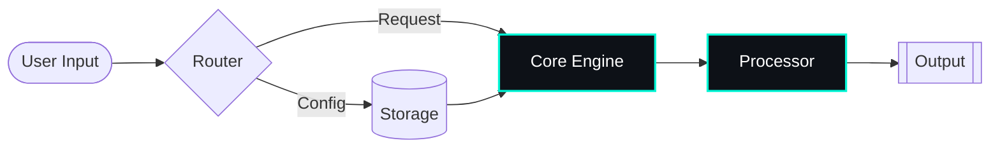

<!-- ═══════════════════════ HEADER BANNER ═══════════════════════ -->
<div align="center">


<a href="https://git.io/typing-svg">
  
</a>

<br/><br/>

<!-- ─────────── BADGES ─────────── -->
<p>
  <a href="https://github.com/celestial-relic/REPO_NAME/stargazers"></a>
  <a href="https://github.com/celestial-relic/REPO_NAME/network/members"></a>
  <a href="https://github.com/celestial-relic/REPO_NAME/issues"></a>
  <a href="https://github.com/celestial-relic/REPO_NAME/blob/main/LICENSE"></a>
</p>
<p>
  
  
  
  
  
</p>

<!-- ─────────── QUICK NAV ─────────── -->
<p>
  <a href="#-overview"><b>Overview</b></a> ·
  <a href="#-features"><b>Features</b></a> ·
  <a href="#-architecture"><b>Architecture</b></a> ·
  <a href="#-quick-start"><b>Quick Start</b></a> ·
  <a href="#-usage"><b>Usage</b></a> ·
  <a href="#-roadmap"><b>Roadmap</b></a>
</p>

</div>

<br/>

<!-- ═══════════════════════ PREVIEW ═══════════════════════ -->
<div align="center">
  <!-- Replace with a real screenshot or GIF: put it in /assets -->
  
</div>

---

## 🧭 Overview

> [!NOTE]
> Drop your pitch here: what the project is, who it's for, and why it exists. Two or three sentences, punchy.

**REPO_NAME** does `X` so you can `Y` without `Z`.

---

## ⚡ Features

<table>
  <tr>
    <td width="50%">

### 🚀 Blazing Fast
Short line about performance or speed.

    </td>
    <td width="50%">

### 🧩 Modular by Design
Short line about extensibility or plugins.

    </td>
  </tr>
  <tr>
    <td width="50%">

### 🔒 Locked Down
Short line about security or reliability.

    </td>
    <td width="50%">

### 🎛️ Fully Configurable
Short line about config and customization.

    </td>
  </tr>
</table>

---

## 🛠️ Tech Stack

<div align="center">
  
</div>

---

## 🏗️ Architecture



<details>
<summary><b>📁 Project Structure</b></summary>

```bash
REPO_NAME/
├── src/
│   ├── core/          # Main engine
│   ├── utils/         # Helpers
│   └── index.js       # Entry point
├── assets/            # Images, GIFs, banners
├── tests/             # Test suite
├── .github/
│   └── workflows/     # CI/CD pipelines
├── LICENSE
└── README.md
```

</details>

---

## 🚀 Quick Start

> [!IMPORTANT]
> Requires **Node.js ≥ 18** (or whatever your minimum is).

```bash
# 1. Clone the repo
git clone https://github.com/celestial-relic/REPO_NAME.git

# 2. Step inside
cd REPO_NAME

# 3. Install dependencies
npm install

# 4. Fire it up
npm start
```

<details>
<summary><b>🐳 Run with Docker</b></summary>

```bash
docker build -t repo-name .
docker run -p 3000:3000 repo-name
```

</details>

---

## 🎮 Usage

```javascript
import { Thing } from "repo-name";

const thing = new Thing({ option: true });
await thing.run();
```

| Command           | What it does                | Default |
| ----------------- | --------------------------- | :-----: |
| `npm start`       | Launches the app            |    —    |
| `npm run dev`     | Dev mode with hot reload    |    —    |
| `npm test`        | Runs the test suite         |    —    |
| `--verbose`       | Prints detailed logs        | `false` |

---

## 🗺️ Roadmap

- [x] Core engine
- [x] Config system
- [ ] Plugin support
- [ ] Web dashboard
- [ ] Public API

Got an idea? [Open an issue](https://github.com/celestial-relic/REPO_NAME/issues/new).

---

## 📈 Star History

<div align="center">
  <a href="https://star-history.com/#celestial-relic/REPO_NAME&Date">
    <picture>
      <source media="(prefers-color-scheme: dark)" srcset="https://api.star-history.com/svg?repos=celestial-relic/REPO_NAME&type=Date&theme=dark" />
      <source media="(prefers-color-scheme: light)" srcset="https://api.star-history.com/svg?repos=celestial-relic/REPO_NAME&type=Date" />
      
    </picture>
  </a>
</div>

---

## 🤝 Contributing

1. Fork the repo
2. Create your branch: `git checkout -b feature/cool-thing`
3. Commit: `git commit -m "feat: add cool thing"`
4. Push: `git push origin feature/cool-thing`
5. Open a Pull Request

<div align="center">
  <a href="https://github.com/celestial-relic/REPO_NAME/graphs/contributors">
    
  </a>
</div>

---

## 📜 License

Distributed under the **MIT License**. See [`LICENSE`](./LICENSE) for details.

---

<div align="center">

### 💬 Let's Connect

<a href="https://madebymax.netlify.app"></a>
<a href="https://github.com/celestial-relic"></a>

<sub>If this helped you out, drop a ⭐. It keeps the lights on.</sub>


</div>
